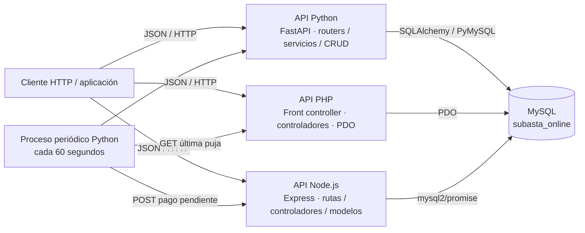
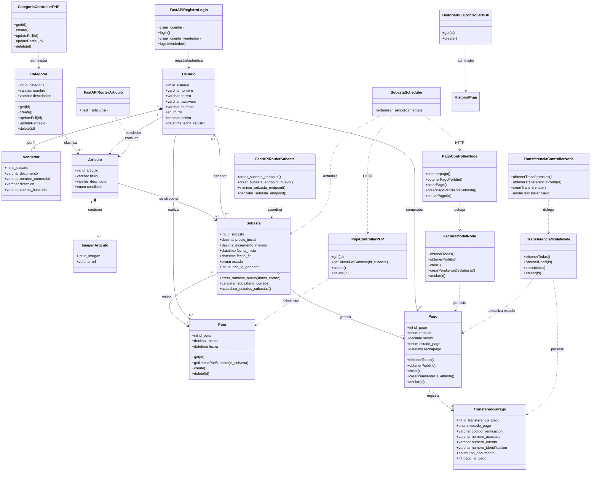
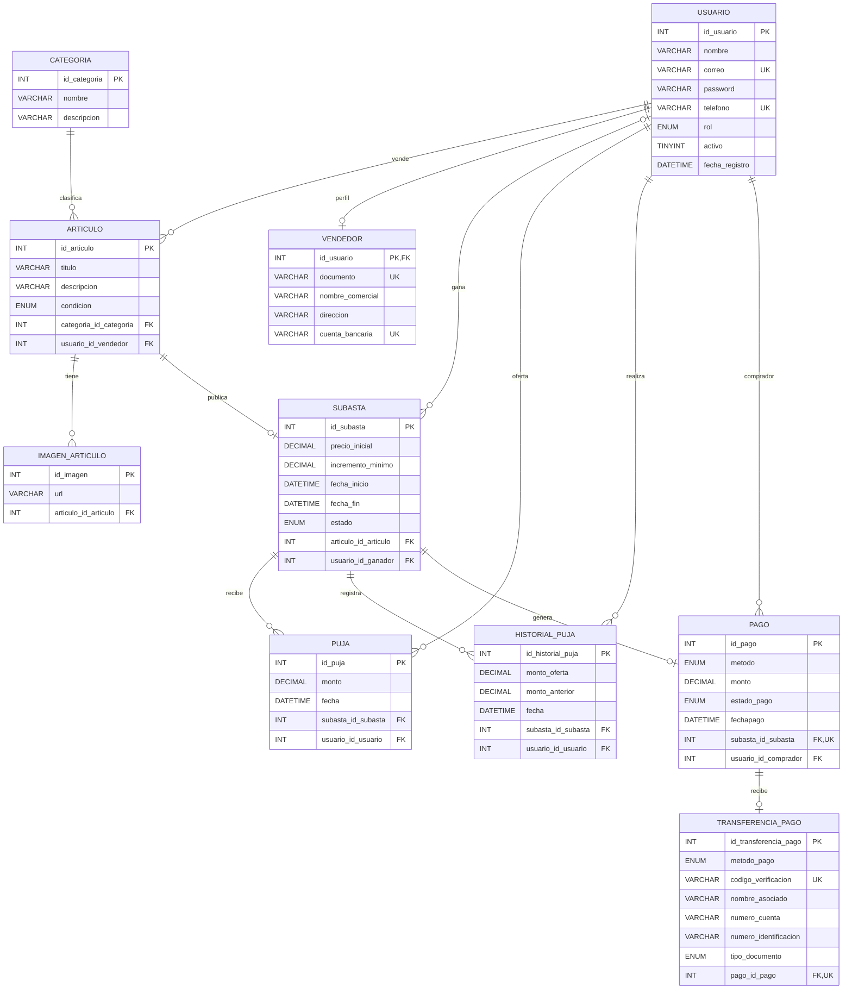

# Documento de Ingeniería de Software

## 1. Portada y Generalidades

### 1.1. Portada

| Dato | Información |
|---|---|
| Universidad | **[Nombre de la universidad]** |
| Asignatura | **[Nombre de la asignatura]** |
| Nombre del proyecto | **SubastaOnline — Sistema de subastas en línea** |
| Integrantes | **[Nombres completos de los integrantes]** |
| Docente | **[Nombre del docente]** |
| Fecha | **5 de octubre de 2026** |

### 1.2. Introducción

SubastaOnline es un backend académico para publicar artículos en subastas, registrar cuentas, permitir ofertas, consultar categorías y generar pagos asociados a la adjudicación. El repositorio combina una API Python con FastAPI y SQLAlchemy, una API PHP con PDO y una API Node.js con Express y `mysql2`. Los tres servicios están configurados para usar la base de datos MySQL `subasta_online`.

La solución aborda la necesidad de coordinar vendedores, compradores y ofertas sobre un artículo con fechas de inicio y fin, evitando depender de un proceso manual para registrar ofertas y cerrar una subasta. El backend incluye autenticación basada en tokens en algunos flujos y un proceso periódico que actualiza el estado de las subastas.

Este análisis se basa en el código y el esquema SQL presentes en el repositorio. Se distingue entre operaciones expuestas, reglas implementadas en código y funcionalidades condicionadas por configuración del entorno.

### 1.3. Objetivo general y objetivos específicos

**Objetivo general:** documentar y evaluar técnicamente la solución backend de SubastaOnline, sus APIs, persistencia, relaciones de datos y forma de ejecución.

**Objetivos específicos:**

1. Identificar las funcionalidades efectivamente expuestas por cada servicio y sus contratos HTTP.
2. Describir las entidades MySQL, sus atributos, restricciones y relaciones.
3. Representar la arquitectura del sistema y el modelo lógico mediante diagramas Mermaid.
4. Señalar diferencias entre el esquema SQL, las rutas y los controladores que pueden afectar la ejecución.
5. Proponer un procedimiento reproducible para iniciar los servicios y validar sus endpoints.

## 2. Definición del Problema y Requisitos

### 2.1. Planteamiento del problema

Una subasta gestionada manualmente depende de que vendedores y compradores acuerden fechas, publiquen artículos, intercambien ofertas y determinen quién ganó. Registrar estos eventos de manera dispersa dificulta consultar la oferta final, comprobar si se alcanzó el mínimo, mantener un historial consistente y generar el cobro correspondiente.

El proyecto propone centralizar la persistencia en MySQL y separar responsabilidades de backend: Python gestiona cuentas, artículos, subastas y su ciclo de vida; PHP gestiona categorías, pujas e historial; Node.js expone operaciones de pagos. Los servicios comparten la misma base de datos y se comunican por HTTP en el flujo de cierre y creación del pago pendiente.

El análisis inicial detectó discrepancias entre controladores y esquema: faltaban las tablas de vendedor e historial, las operaciones de categoría duplicaban el alta y la unicidad de pago no estaba garantizada por SQL. Este cambio alinea el código y los esquemas, aunque permanecen brechas de autenticación/configuración señaladas más adelante.

### 2.2. Alcance del sistema

**Incluye en el código revisado:**

- Registro e inicio de sesión para usuarios y vendedores.
- Alta de artículos e imágenes asociadas durante la creación de una subasta.
- Búsqueda de artículos/subastas con filtros de texto, categoría, precio y fechas.
- Creación, cancelación y eliminación de subastas.
- Cambio periódico de estados de subasta.
- Consulta, creación y eliminación de pujas; consulta de la última puja de una subasta.
- Consulta y creación de pagos, anulación lógica y generación interna de pago pendiente al cierre.
- Administración CRUD declarada para categorías.
- Persistencia MySQL compartida entre servicios.

**No se considera incluido o no se pudo verificar:**

- Procesamiento real de tarjetas, pasarela bancaria, conciliación o confirmación externa del pago.
- Procesamiento externo/conciliación de transferencias: Node registra los datos declarados y actualiza el estado del pago, pero no consulta una entidad financiera ni valida el comprobante con el proveedor.
- CRUD independiente completo de vendedor, artículo, imágenes, subasta o historial.
- Autorización uniforme y granular para todos los endpoints.
- Aplicación frontend operativa, pruebas automatizadas completas, contenedores o infraestructura de producción.
- Registro automático de historial por cada puja nueva: la tabla/endpoints de historial permiten operaciones explícitas, pero el controlador de pujas no los invoca.

### 2.3. Requisitos funcionales (RF)

| ID | Requisito verificable |
|---|---|
| RF01 | El sistema debe permitir crear una cuenta de usuario con nombre, correo, contraseña, teléfono, rol, estado activo y fecha de registro. |
| RF02 | El sistema debe permitir autenticar usuarios y vendedores mediante correo y contraseña y devolver un token de acceso. |
| RF03 | El sistema debe permitir registrar los datos extendidos de un vendedor, incluyendo documento, nombre comercial, dirección y cuenta bancaria. |
| RF04 | El sistema debe permitir a un vendedor crear una subasta y su artículo asociado, con categoría, condición, fechas, precio inicial, incremento mínimo e imágenes. |
| RF05 | El sistema debe permitir cancelar una subasta aún no finalizada, previa validación de que el vendedor solicitante sea su propietario. |
| RF06 | El sistema debe permitir eliminar una subasta y el artículo asociado cuando las relaciones y restricciones de integridad lo permitan. |
| RF07 | El sistema debe buscar artículos/subastas usando filtros de nombre, categoría, rango de precio y rango de fechas, con un máximo de 50 subastas por búsqueda. |
| RF08 | El sistema debe permitir consultar categorías, crear categorías, modificarlas y eliminarlas mediante las rutas PHP declaradas. |
| RF09 | El sistema debe aceptar una puja únicamente si la subasta está vigente, la oferta cumple el incremento mínimo y el usuario no es quien ofertó inmediatamente antes. |
| RF10 | El sistema debe permitir consultar pujas y consultar la última puja registrada para una subasta. |
| RF11 | El sistema debe actualizar el estado de subastas programadas y en curso de acuerdo con sus fechas. |
| RF12 | Al finalizar una subasta, el sistema debe adjudicarla al usuario de la última puja si esta alcanza al menos el precio inicial y debe solicitar un pago con estado `en_espera`. |
| RF13 | El sistema debe permitir consultar pagos, crear un pago genérico y marcar un pago como rechazado. |
| RF14 | El endpoint especializado debe buscar o crear un pago pendiente para una subasta a partir del correo del comprador activo; el esquema garantiza un pago por subasta mediante restricción única. |
| RF15 | El sistema debe permitir consultar y crear registros de historial mediante el controlador PHP. |
| RF16 | El sistema debe permitir registrar una transferencia asociada a un pago en espera, actualizar el pago a realizado y anular la transferencia cambiando el pago a rechazado. |

### 2.4. Requisitos no funcionales (RNF)

| ID | Atributo | Evidencia / observación |
|---|---|---|
| RNF01 | Persistencia relacional | MySQL/InnoDB; el encabezado del dump `DataBase/subasta_online.sql` declara servidor MySQL 9.6.0. Verificar la versión real del servidor instalado antes del despliegue. |
| RNF02 | Seguridad de identidad | FastAPI usa JWT firmado en algunas rutas; el endpoint Node de pago pendiente identifica al comprador por correo, pero el correo no autentica a quien llama. |
| RNF03 | Autorización | Python emite y valida roles `vendedor`, `comprador` y `admin` consistentes con el enum SQL. PHP y Node no muestran middleware de autorización. |
| RNF04 | Validación | Pydantic valida payloads Python; PHP valida pujas; Node valida datos de pago pendiente y transferencias. La cobertura no es uniforme. |
| RNF05 | Concurrencia | El registro PHP de pujas bloquea la fila de subasta con `FOR UPDATE`. El cierre Python vuelve a bloquear la subasta para confirmar el estado antes de actualizarla. |
| RNF06 | Consistencia | Se emplean claves foráneas InnoDB, restricciones `UNIQUE` para correo, teléfono, categoría, artículo por subasta, pago por subasta, transferencia por pago, documento/cuenta de vendedor y código de verificación, además de `CHECK` para importes y fechas. |
| RNF07 | Disponibilidad del cierre | Python ejecuta un proceso en segundo plano que revisa subastas cada 60 segundos; ante error de cierre, registra la excepción y vuelve a intentar en el siguiente ciclo. |
| RNF08 | Interoperabilidad | Las APIs intercambian JSON sobre HTTP. La URL completa de PHP depende del servidor web/rewrite configurado. |
| RNF09 | Rendimiento | La búsqueda limita a 50 subastas; no se encontraron SLO, pruebas de carga ni límites de paginación general documentados. |
| RNF10 | Configuración | Python y Node.js leen variables de entorno y ofrecen valores locales por defecto; PDO de PHP contiene configuración en un archivo PHP. Externalizar credenciales y retirar valores por defecto inseguros antes de producción. |
| RNF11 | Operabilidad | FastAPI ofrece documentación OpenAPI automática, normalmente en `/docs` y `/openapi.json`, salvo personalización del despliegue. |

## 3. Arquitectura y Diseño del Sistema (UML)

### 3.1. Diagrama de arquitectura

Los tres procesos son servicios independientes, pero el código los configura contra la misma instancia/esquema MySQL. Por tanto, el modelo observado es una **base de datos centralizada compartida**, no tres bases distribuidas. Python también llama al endpoint PHP para leer la última puja y al endpoint Node para generar el pago pendiente.



**Flujos destacados:**

1. El alta de vendedor/usuario pasa por Python y persiste en MySQL.
2. La creación de subasta en Python crea el artículo, sus imágenes y la fila de subasta.
3. PHP registra pujas y consulta su orden cronológico.
4. El scheduler Python cambia estados y, al vencer una subasta, obtiene de PHP la última puja.
5. Si se alcanza el precio inicial, Python solicita a Node el pago pendiente antes de fijar el ganador y terminar la subasta.

### 3.2. Diagrama de clases UML

El diagrama representa las entidades presentes en el SQL principal y los componentes de aplicación identificados. Los atributos de entidades se expresan como campos de persistencia; los métodos representan operaciones observadas en controladores, servicios o modelos.



**Nota de consistencia:** el DDL crea las tablas `vendedor` y `historial_puja`. La modalidad del pago (`efectivo` o `transferencia`) se registra en `pago.metodo`; los valores `nequi`, `bancolombia` y `mercadopago` identifican el proveedor dentro de `transferencia_pago`, que solo existe cuando hay datos de transferencia.

### 3.3. Patrón de diseño y estructura del código

- **Python:** capas parciales: routers FastAPI → servicios de aplicación → funciones CRUD/repositorio que usan `SessionLocal` y SQL textual de SQLAlchemy. `subasta_scheduler.py` es un proceso de ciclo de vida de FastAPI y no un endpoint HTTP.
- **PHP:** front controller (`index.php`) que enruta por primer segmento de URL → controladores → conexión PDO. No se observa una capa de servicio/repository separada.
- **Node.js:** estructura tipo MVC/Layered: Express routes → controller → model → pool `mysql2`.
- **Persistencia:** esquema relacional MySQL común con claves foráneas e InnoDB.
- **Estilo de APIs:** recursos HTTP/JSON mezclados con rutas de acción en español (por ejemplo `/CrearSubasta`, `/Login`, `/EliminarSubasta`), no una convención REST uniforme.
- **No se observó:** especificación OpenAPI mantenida manualmente, ORM declarativo para todas las entidades, capa de mensajería/eventos, contenedor Docker ni estrategia de versionado de API.

## 4. Modelado y Diseño de la Base de Datos

### 4.1. Modelo Entidad-Relación (MER / DER)



Las claves únicas limitan a una subasta por artículo, un pago por subasta y una transferencia por pago. Una transferencia es opcional, ya que los pagos en efectivo no tienen fila en `transferencia_pago`.

### 4.2. Diccionario de datos

Tipos, longitudes y restricciones se transcriben del esquema actual. `AUTO_INCREMENT` se abrevia como `AI`; `PK`, `FK` y `UK` significan clave primaria, foránea y única.

#### `usuario`

| Campo | Tipo / longitud | Restricciones | Descripción |
|---|---|---|---|
| `id_usuario` | `INT` | PK, NOT NULL, AI | Identificador de usuario. |
| `nombre` | `VARCHAR(45)` | NOT NULL | Nombre de la persona. |
| `correo` | `VARCHAR(100)` | NOT NULL, UK | Correo de acceso. |
| `password` | `VARCHAR(255)` | NOT NULL | Contraseña almacenada; la lógica Python la procesa como hash. |
| `telefono` | `VARCHAR(13)` | NOT NULL, UK | Teléfono de contacto. |
| `rol` | `ENUM('vendedor','comprador','admin')` | NOT NULL | Rol de la cuenta. |
| `activo` | `TINYINT(1)` | NOT NULL, DEFAULT 1 | Indicador de cuenta activa. |
| `fecha_registro` | `DATETIME` | NOT NULL, DEFAULT CURRENT_TIMESTAMP | Fecha de creación de la cuenta. |

#### `categoria`

| Campo | Tipo / longitud | Restricciones | Descripción |
|---|---|---|---|
| `id_categoria` | `INT` | PK, NOT NULL, AI | Identificador de categoría. |
| `nombre` | `VARCHAR(45)` | NOT NULL, UK, CHECK no vacío | Nombre de categoría. |
| `descripcion` | `VARCHAR(255)` | NULL | Descripción opcional. |

#### `articulo`

| Campo | Tipo / longitud | Restricciones | Descripción |
|---|---|---|---|
| `id_articulo` | `INT` | PK, NOT NULL, AI | Identificador del artículo. |
| `titulo` | `VARCHAR(45)` | NOT NULL | Nombre/título del artículo. |
| `descripcion` | `VARCHAR(255)` | NULL | Descripción del artículo. |
| `condicion` | `ENUM('nuevo','bueno','medio','malo')` | NOT NULL | Estado físico declarado. |
| `categoria_id_categoria` | `INT` | FK, NOT NULL | Referencia a `categoria.id_categoria`. |
| `usuario_id_vendedor` | `INT` | FK, NOT NULL | Referencia al vendedor en `usuario.id_usuario`. |

#### `imagen_articulo`

| Campo | Tipo / longitud | Restricciones | Descripción |
|---|---|---|---|
| `id_imagen` | `INT` | PK, NOT NULL, AI | Identificador de imagen. |
| `url` | `VARCHAR(255)` | NOT NULL | URL/ruta de imagen. |
| `articulo_id_articulo` | `INT` | FK, NOT NULL | Referencia a `articulo.id_articulo`; `ON DELETE CASCADE`. |

#### `subasta`

| Campo | Tipo / longitud | Restricciones | Descripción |
|---|---|---|---|
| `id_subasta` | `INT` | PK, NOT NULL, AI | Identificador de subasta. |
| `precio_inicial` | `DECIMAL(10,2)` | NOT NULL, CHECK >= 0 | Precio de apertura y umbral usado como mínimo de adjudicación en el cierre. |
| `incremento_minimo` | `DECIMAL(10,2)` | NOT NULL, CHECK > 0 | Incremento mínimo exigido por PHP para aceptar otra oferta. |
| `fecha_inicio` | `DATETIME` | NOT NULL | Inicio programado. |
| `fecha_fin` | `DATETIME` | NOT NULL, CHECK > `fecha_inicio` | Fin programado. |
| `estado` | `ENUM('en_curso','por_empezar','terminada','cancelada')` | NOT NULL | Estado del ciclo de vida. |
| `articulo_id_articulo` | `INT` | FK, NOT NULL, UK | Referencia al artículo subastado; máximo una subasta por artículo. |
| `usuario_id_ganador` | `INT` | FK, NULL | Usuario adjudicado al cierre; permite ausencia de ganador. |

#### `puja`

| Campo | Tipo / longitud | Restricciones | Descripción |
|---|---|---|---|
| `id_puja` | `INT` | PK, NOT NULL, AI | Identificador de la puja. |
| `monto` | `DECIMAL(10,2)` | NOT NULL, CHECK > 0 | Importe ofertado. |
| `fecha` | `DATETIME` | NOT NULL, DEFAULT CURRENT_TIMESTAMP | Momento de la puja. |
| `subasta_id_subasta` | `INT` | FK, NOT NULL | Referencia a `subasta.id_subasta`. |
| `usuario_id_usuario` | `INT` | FK, NOT NULL | Usuario que realizó la puja. |

#### `pago`

| Campo | Tipo / longitud | Restricciones | Descripción |
|---|---|---|---|
| `id_pago` | `INT` | PK, NOT NULL, AI | Identificador del pago. |
| `metodo` | `ENUM('efectivo','transferencia')` | NOT NULL, DEFAULT `transferencia` | Medio de pago. |
| `monto` | `DECIMAL(10,2)` | NOT NULL, CHECK > 0 | Importe adeudado/ofertado. |
| `estado_pago` | `ENUM('realizado','en_espera','rechazado')` | NOT NULL | Estado del pago. |
| `fechapago` | `DATETIME` | NULL | Fecha de pago; el pago pendiente la deja nula. |
| `subasta_id_subasta` | `INT` | FK, NOT NULL, UK | Subasta que originó el pago; solo se permite un pago por subasta. |
| `usuario_id_comprador` | `INT` | FK, NOT NULL | Comprador ganador asociado al pago. |

#### `vendedor`

| Campo | Tipo / longitud | Restricciones | Descripción |
|---|---|---|---|
| `id_usuario` | `INT` | PK, FK, NOT NULL | Usuario propietario del perfil extendido de vendedor. |
| `documento` | `VARCHAR(45)` | NOT NULL, UK, CHECK longitud >= 6 | Documento único del vendedor. |
| `nombre_comercial` | `VARCHAR(100)` | NOT NULL | Nombre comercial. |
| `direccion` | `VARCHAR(255)` | NOT NULL | Dirección del vendedor. |
| `cuenta_bancaria` | `VARCHAR(45)` | NOT NULL, UK, CHECK longitud >= 6 | Cuenta bancaria única. |

#### `historial_puja`

| Campo | Tipo / longitud | Restricciones | Descripción |
|---|---|---|---|
| `id_historial_puja` | `INT` | PK, NOT NULL, AI | Identificador del registro de historial. |
| `monto_oferta` | `DECIMAL(10,2)` | NOT NULL, CHECK > 0 | Monto registrado. |
| `monto_anterior` | `DECIMAL(10,2)` | NOT NULL, DEFAULT 0, CHECK >= 0 | Monto de la oferta previa. |
| `fecha` | `DATETIME` | NOT NULL, DEFAULT CURRENT_TIMESTAMP | Fecha del registro. |
| `subasta_id_subasta` | `INT` | FK, NOT NULL | Subasta asociada. |
| `usuario_id_usuario` | `INT` | FK, NOT NULL | Usuario que ofertó. |

#### `transferencia_pago`

| Campo | Tipo / longitud | Restricciones | Descripción |
|---|---|---|---|
| `id_transferencia_pago` | `INT` | PK, NOT NULL, AI | Identificador de la transferencia declarada. |
| `metodo_pago` | `ENUM('nequi','bancolombia','mercadopago')` | NOT NULL | Medio informado para la transferencia. |
| `codigo_verificacion` | `VARCHAR(45)` | NOT NULL, UK | Código/referencia único informado por el cliente. |
| `nombre_asociado` | `VARCHAR(100)` | NOT NULL | Nombre del titular informado. |
| `numero_cuenta` | `VARCHAR(45)` | NOT NULL | Cuenta o número asociado a la transferencia. |
| `numero_identificacion` | `VARCHAR(45)` | NOT NULL | Identificación del titular. |
| `tipo_documento` | `ENUM('CC','TI','CE','PAS','NIT','PEP','PPT')` | NOT NULL | Tipo de documento informado. |
| `pago_id_pago` | `INT` | FK, NOT NULL, UK | Pago relacionado; FK con `ON DELETE CASCADE ON UPDATE CASCADE`; cada pago admite una transferencia. |

La cuenta bancaria y los datos de identificación se almacenan únicamente en `vendedor` o `transferencia_pago`; no hay columnas de cuenta bancaria en `pago`, por lo que el método en efectivo no requiere ni guarda una cuenta.

### 4.3. Script de creación

El script completo de referencia es [`DataBase/subasta_online.sql`](DataBase/subasta_online.sql); la migración para bases existentes está en [`DataBase/migrations/001_align_schema.sql`](DataBase/migrations/001_align_schema.sql). El siguiente DDL compacto muestra las restricciones y entidades añadidas, y no incluye datos semilla ni las demás tablas:

```sql
CREATE DATABASE IF NOT EXISTS subasta_online
  DEFAULT CHARACTER SET utf8mb4 COLLATE utf8mb4_0900_ai_ci;
USE subasta_online;

CREATE TABLE usuario (
  id_usuario INT NOT NULL AUTO_INCREMENT,
  nombre VARCHAR(45) NOT NULL,
  correo VARCHAR(100) NOT NULL,
  password VARCHAR(255) NOT NULL,
  telefono VARCHAR(13) NOT NULL,
  rol ENUM('vendedor','comprador','admin') NOT NULL,
  activo TINYINT(1) NOT NULL DEFAULT 1,
  fecha_registro DATETIME NOT NULL DEFAULT CURRENT_TIMESTAMP,
  PRIMARY KEY (id_usuario),
  UNIQUE KEY correo_UNIQUE (correo),
  UNIQUE KEY telefono_UNIQUE (telefono),
  CONSTRAINT chk_usuario_activo CHECK (activo IN (0, 1))
) ENGINE=InnoDB DEFAULT CHARSET=utf8mb4 COLLATE=utf8mb4_0900_ai_ci;

CREATE TABLE categoria (
  id_categoria INT NOT NULL AUTO_INCREMENT,
  nombre VARCHAR(45) NOT NULL,
  descripcion VARCHAR(255) DEFAULT NULL,
  PRIMARY KEY (id_categoria),
  UNIQUE KEY nombre_UNIQUE (nombre),
  CONSTRAINT chk_categoria_nombre CHECK (CHAR_LENGTH(TRIM(nombre)) > 0)
) ENGINE=InnoDB DEFAULT CHARSET=utf8mb4 COLLATE=utf8mb4_0900_ai_ci;

CREATE TABLE articulo (
  id_articulo INT NOT NULL AUTO_INCREMENT,
  titulo VARCHAR(45) NOT NULL,
  descripcion VARCHAR(255) DEFAULT NULL,
  condicion ENUM('nuevo','bueno','medio','malo') NOT NULL,
  categoria_id_categoria INT NOT NULL,
  usuario_id_vendedor INT NOT NULL,
  PRIMARY KEY (id_articulo),
  KEY fk_articulo_categoria (categoria_id_categoria),
  KEY fk_articulo_usuario (usuario_id_vendedor),
  CONSTRAINT fk_articulo_categoria FOREIGN KEY (categoria_id_categoria)
    REFERENCES categoria (id_categoria),
  CONSTRAINT fk_articulo_usuario FOREIGN KEY (usuario_id_vendedor)
    REFERENCES usuario (id_usuario)
) ENGINE=InnoDB DEFAULT CHARSET=utf8mb4 COLLATE=utf8mb4_0900_ai_ci;

CREATE TABLE imagen_articulo (
  id_imagen INT NOT NULL AUTO_INCREMENT,
  url VARCHAR(255) NOT NULL,
  articulo_id_articulo INT NOT NULL,
  PRIMARY KEY (id_imagen),
  KEY fk_imagen_articulo (articulo_id_articulo),
  CONSTRAINT fk_imagen_articulo FOREIGN KEY (articulo_id_articulo)
    REFERENCES articulo (id_articulo) ON DELETE CASCADE
) ENGINE=InnoDB DEFAULT CHARSET=utf8mb4 COLLATE=utf8mb4_0900_ai_ci;

CREATE TABLE subasta (
  id_subasta INT NOT NULL AUTO_INCREMENT,
  precio_inicial DECIMAL(10,2) NOT NULL,
  incremento_minimo DECIMAL(10,2) NOT NULL,
  fecha_inicio DATETIME NOT NULL,
  fecha_fin DATETIME NOT NULL,
  estado ENUM('en_curso','por_empezar','terminada','cancelada') NOT NULL,
  articulo_id_articulo INT NOT NULL,
  usuario_id_ganador INT DEFAULT NULL,
  PRIMARY KEY (id_subasta),
  UNIQUE KEY articulo_id_articulo_UNIQUE (articulo_id_articulo),
  KEY fk_subasta_articulo (articulo_id_articulo),
  KEY fk_subasta_ganador (usuario_id_ganador),
  CONSTRAINT fk_subasta_articulo FOREIGN KEY (articulo_id_articulo)
    REFERENCES articulo (id_articulo),
  CONSTRAINT fk_subasta_ganador FOREIGN KEY (usuario_id_ganador)
    REFERENCES usuario (id_usuario),
  CONSTRAINT chk_subasta_precio_inicial CHECK (precio_inicial >= 0),
  CONSTRAINT chk_subasta_incremento_minimo CHECK (incremento_minimo > 0),
  CONSTRAINT chk_subasta_fechas CHECK (fecha_inicio < fecha_fin)
) ENGINE=InnoDB DEFAULT CHARSET=utf8mb4 COLLATE=utf8mb4_0900_ai_ci;

CREATE TABLE puja (
  id_puja INT NOT NULL AUTO_INCREMENT,
  monto DECIMAL(10,2) NOT NULL,
  fecha DATETIME NOT NULL DEFAULT CURRENT_TIMESTAMP,
  subasta_id_subasta INT NOT NULL,
  usuario_id_usuario INT NOT NULL,
  PRIMARY KEY (id_puja),
  KEY fk_puja_subasta (subasta_id_subasta),
  KEY fk_puja_usuario (usuario_id_usuario),
  CONSTRAINT fk_puja_subasta FOREIGN KEY (subasta_id_subasta)
    REFERENCES subasta (id_subasta),
  CONSTRAINT fk_puja_usuario FOREIGN KEY (usuario_id_usuario)
    REFERENCES usuario (id_usuario),
  CONSTRAINT chk_puja_monto CHECK (monto > 0)
) ENGINE=InnoDB DEFAULT CHARSET=utf8mb4 COLLATE=utf8mb4_0900_ai_ci;

CREATE TABLE pago (
  id_pago INT NOT NULL AUTO_INCREMENT,
  metodo ENUM('efectivo','transferencia') NOT NULL DEFAULT 'transferencia',
  monto DECIMAL(10,2) NOT NULL,
  estado_pago ENUM('realizado','en_espera','rechazado') NOT NULL,
  fechapago DATETIME DEFAULT NULL,
  subasta_id_subasta INT NOT NULL,
  usuario_id_comprador INT NOT NULL,
  PRIMARY KEY (id_pago),
  UNIQUE KEY subasta_id_subasta_UNIQUE (subasta_id_subasta),
  KEY fk_pago_usuario (usuario_id_comprador),
  CONSTRAINT fk_pago_subasta FOREIGN KEY (subasta_id_subasta)
    REFERENCES subasta (id_subasta),
  CONSTRAINT fk_pago_usuario FOREIGN KEY (usuario_id_comprador)
    REFERENCES usuario (id_usuario),
  CONSTRAINT chk_pago_monto CHECK (monto > 0)
) ENGINE=InnoDB DEFAULT CHARSET=utf8mb4 COLLATE=utf8mb4_0900_ai_ci;

CREATE TABLE transferencia_pago (
  id_transferencia_pago INT NOT NULL AUTO_INCREMENT,
  metodo_pago ENUM('nequi','bancolombia','mercadopago') NOT NULL,
  codigo_verificacion VARCHAR(45) NOT NULL,
  nombre_asociado VARCHAR(100) NOT NULL,
  numero_cuenta VARCHAR(45) NOT NULL,
  numero_identificacion VARCHAR(45) NOT NULL,
  tipo_documento ENUM('CC','TI','CE','PAS','NIT','PEP','PPT') NOT NULL,
  pago_id_pago INT NOT NULL,
  PRIMARY KEY (id_transferencia_pago),
  UNIQUE KEY codigo_verificacion_UNIQUE (codigo_verificacion),
  UNIQUE KEY pago_id_pago_UNIQUE (pago_id_pago),
  CONSTRAINT fk_transferencia_pago_pago FOREIGN KEY (pago_id_pago)
    REFERENCES pago (id_pago) ON DELETE CASCADE ON UPDATE CASCADE
) ENGINE=InnoDB DEFAULT CHARSET=utf8mb4 COLLATE=utf8mb4_0900_ai_ci;

CREATE TABLE vendedor (
  id_usuario INT NOT NULL,
  documento VARCHAR(45) NOT NULL,
  nombre_comercial VARCHAR(100) NOT NULL,
  direccion VARCHAR(255) NOT NULL,
  cuenta_bancaria VARCHAR(45) NOT NULL,
  PRIMARY KEY (id_usuario),
  UNIQUE KEY documento_UNIQUE (documento),
  UNIQUE KEY cuenta_bancaria_UNIQUE (cuenta_bancaria),
  CONSTRAINT fk_vendedor_usuario FOREIGN KEY (id_usuario)
    REFERENCES usuario (id_usuario) ON DELETE CASCADE ON UPDATE CASCADE,
  CONSTRAINT chk_vendedor_documento CHECK (CHAR_LENGTH(TRIM(documento)) >= 6),
  CONSTRAINT chk_vendedor_cuenta_bancaria
    CHECK (CHAR_LENGTH(TRIM(cuenta_bancaria)) >= 6)
) ENGINE=InnoDB DEFAULT CHARSET=utf8mb4 COLLATE=utf8mb4_0900_ai_ci;

CREATE TABLE historial_puja (
  id_historial_puja INT NOT NULL AUTO_INCREMENT,
  monto_oferta DECIMAL(10,2) NOT NULL,
  monto_anterior DECIMAL(10,2) NOT NULL DEFAULT 0,
  fecha DATETIME NOT NULL DEFAULT CURRENT_TIMESTAMP,
  subasta_id_subasta INT NOT NULL,
  usuario_id_usuario INT NOT NULL,
  PRIMARY KEY (id_historial_puja),
  KEY fk_historial_puja_subasta (subasta_id_subasta),
  KEY fk_historial_puja_usuario (usuario_id_usuario),
  CONSTRAINT fk_historial_puja_subasta FOREIGN KEY (subasta_id_subasta)
    REFERENCES subasta (id_subasta),
  CONSTRAINT fk_historial_puja_usuario FOREIGN KEY (usuario_id_usuario)
    REFERENCES usuario (id_usuario),
  CONSTRAINT chk_historial_puja_monto_oferta CHECK (monto_oferta > 0),
  CONSTRAINT chk_historial_puja_monto_anterior CHECK (monto_anterior >= 0)
) ENGINE=InnoDB DEFAULT CHARSET=utf8mb4 COLLATE=utf8mb4_0900_ai_ci;
```

**Nota de aplicación de la migración:** revisar las cuatro consultas de duplicados incluidas en el archivo antes de aplicar los índices únicos a una base existente. El dump completo se debe usar solo para instalaciones nuevas, porque elimina y recrea tablas.

## 5. Especificación Técnica de las 3 APIs

### 5.1. API 1 — Python / FastAPI

**Propósito:** registro y login, administración/consulta de artículos, creación y ciclo de vida de subastas, y coordinación automática del cierre.

**Base URL de desarrollo propuesta:** `http://localhost:8000`. La URL efectiva depende del comando de inicio. OpenAPI: `/docs`; especificación: `/openapi.json`.

#### Catálogo de endpoints

| Método | Ruta | Descripción | Entrada principal | Respuesta normal |
|---|---|---|---|---|
| `GET` | `/` | Verifica que la API responde. | Ninguna. | `200 {"message":"Hola desde el servidor"}` |
| `POST` | `/CrearCuenta` | Registra usuario. | JSON `UsuarioCreate`; ejemplo abajo. | `201 {"message": ...}` |
| `POST` | `/Login` | Autentica usuario. | JSON `{correo,password}`. | `200 {"message":{...access_token...}}` |
| `POST` | `/CrearCuentaVendedor` | Registra vendedor y datos extendidos. | JSON `UsuarioCreateVendedor`. | `201 {"message": ...}` |
| `POST` | `/LoginVendedor` | Autentica vendedor. | JSON `{correo,password}`. | `200 {"message":{...access_token...}}` |
| `POST` | `/pedirArticulo` | Busca artículos/subastas; requiere Bearer con rol `user`. | Filtros JSON opcionales: nombre, categoría, precios y fechas. | `200 {total,limite,resultados}` |
| `POST` | `/CrearSubasta` | Crea artículo, imágenes y subasta. Requiere Bearer con rol `vendedor`. | JSON `CreateSubasta`, incluye `precio_actual`. | `201 {"message":...}` |
| `POST` | `/CrearSubastaNuevo` | Variante que recibe correo del vendedor en el body. No declara dependencia JWT en la ruta. | JSON de creación más `vendedor_correo`; no incluye `precio_actual`. | `201` con resultado de creación. |
| `DELETE` | `/EliminarSubasta` | Elimina subasta y artículo asociado. | JSON `{"id_subasta": 123}` o alias `{"subasta_id":123}`. | `200 {"message":"Subasta y artículo eliminados correctamente"}` |
| `POST` | `/CancelarSubasta` | Cancela si no venció y el correo corresponde al vendedor propietario. | JSON `{"id_subasta":123,"vendedor_correo":"vendedor@example.com"}`. | `200 {"message":"Subasta cancelada correctamente"}` |
| `PUT` | `/ModificarSubasta` | Modifica campos permitidos de una subasta propiedad del correo enviado en el body. | `id_subasta`, `vendedor_correo` y opcionalmente `precio_inicial`, `incremento_minimo`, `fecha_inicio`, `fecha_fin`, `estado`. | `200 {"message":...}`; validación Pydantic `422`; errores de negocio conforme al servicio. |
| `PUT` | `/ModificarUsuario` | Actualiza datos del usuario autenticado. | Bearer JWT de usuario; body parcial `nombre`, `password` y/o `telefono`. | `200 {"message":...}`; el router verifica rol de usuario. |

**Request de ejemplo — registro de usuario**

```json
{
  "nombre": "Ana Compradora",
  "correo": "ana@example.com",
  "password": "una-clave-segura",
  "telefono": "3001234567",
  "rol": "comprador",
  "activo": true,
  "fecha_registro": "2026-10-04T12:00:00"
}
```

**Request de ejemplo — búsqueda**

```json
{
  "nombre": "bicicleta",
  "categoria": "deportes",
  "precio_inicial": 100,
  "precio_final": 500,
  "fecha_inicio": "2026-10-01",
  "fecha_fin": "2026-10-31"
}
```

La búsqueda devuelve `total`, `limite` (50) y una lista con ID de subasta y artículo, título, descripción, condición, categoría, precios, fechas, estado e imágenes.

**Request de ejemplo — crear subasta con JWT**

```http
Authorization: Bearer <JWT_DE_ACCESO>
Content-Type: application/json
```

```json
{
  "precio_inicial": 100,
  "incremento_minimo": 10,
  "precio_actual": 100,
  "fecha_inicio": "2026-10-05T09:00:00",
  "fecha_fin": "2026-10-10T18:00:00",
  "estado": "por_empezar",
  "titulo": "Bicicleta urbana",
  "descripcion": "Bicicleta usada en buen estado",
  "condicion": "bueno",
  "imagen_url": ["https://example.com/bici.jpg"],
  "categoria": "deportes"
}
```

**Requests de ejemplo — modificación de usuario y subasta**

`PUT http://localhost:8000/ModificarUsuario` (Bearer JWT obligatorio):

```json
{
  "nombre": "Ana Actualizada",
  "telefono": "3001234568"
}
```

`PUT http://localhost:8000/ModificarSubasta` (los campos de modificación son opcionales; el correo se usa para comprobar propiedad, no sustituye autenticación):

```json
{
  "id_subasta": 15,
  "vendedor_correo": "vendedor@example.com",
  "incremento_minimo": 15,
  "estado": "en_curso"
}
```

**Códigos de error habituales:** `400` por validación/reglas de negocio; `401` si falta o no se valida Bearer; `403` si el rol no corresponde; `404` al no encontrar recurso (por ejemplo, al borrar); `409` en conflictos de cancelación/eliminación; `500` ante fallos de persistencia u otros errores no controlados. FastAPI/Pydantic puede responder `422` para cuerpos que no cumplen el modelo.

**Notas del contrato:** el payload exacto de `message` depende del servicio; los endpoints de creación no devuelven un formato de recurso uniforme. `CrearSubastaNuevo` recibe un correo como dato, y el código revisado no le exige token de vendedor.

La autorización vigente para `/pedirArticulo` acepta los roles `comprador` y `admin`, coherentes con el enum SQL; los tokens antiguos que usaban el rol interno `user` deben renovarse iniciando sesión de nuevo.

### 5.2. API 2 — PHP / PDO

**Propósito:** administración de categorías, escritura/consulta de pujas e historial de pujas, incluida la consulta de la última puja usada por el cierre Python.

**Base URL:** depende del servidor PHP. El código interpreta paths como `/categoria` y `/puja`; requiere que Apache/Nginx enrute la solicitud a `backend/php/index.php`. En desarrollo, puede usarse el servidor PHP integrado con un router compatible. Los paths siguientes son los segmentos que consume el front controller.

#### Categorías (`categoria`)

| Método | Ruta | Descripción | Entrada | Éxito |
|---|---|---|---|---|
| `GET` | `/categoria` | Lista categorías. | Sin parámetros. | `200 {"status":"success","data":[...]}` |
| `GET` | `/categoria/{id}` | Consulta categoría por ID. | Path `id`. | `200 {"status":"success","data":{...}}`; si no existe, `404`. |
| `POST` | `/categoria` | Crea categoría. | JSON `{"nombre":"...","descripcion":"..."}`. | `201`, body con `status` e `id`. |
| `PUT` | `/categoria/{id}` | Reemplaza nombre y descripción. | Path `id`, JSON con `nombre` y `descripcion` opcional. | Body `{"status":"success"}`; `404` si no existe. |
| `PATCH` | `/categoria/{id}` | Actualiza parcialmente la categoría. | Path `id`, JSON con `nombre` y/o `descripcion`. | Body `{"status":"success"}`; `404` si no existe. |
| `DELETE` | `/categoria/{id}` | Elimina categoría. | Path `id`. | Body `{"status":"success"}` si la consulta se ejecuta. |

#### Pujas (`puja`)

| Método | Ruta | Descripción | Entrada | Éxito |
|---|---|---|---|---|
| `GET` | `/puja` | Lista pujas. | Sin parámetros. | `200 {"status":"success","data":[...]}` |
| `GET` | `/puja/{id}` | Consulta una puja por su ID. | Path `id_puja`. | `200 {"status":"success","data":{...}}`; `404` si no existe. |
| `GET` | `/puja/ultima/{id_subasta}` | Devuelve la puja más reciente de la subasta, por `fecha DESC, id_puja DESC`. | Path `id_subasta`. | `200 {"status":"success","data":{puja...}}` o `data:null` sin pujas. |
| `POST` | `/puja` | Registra una puja tras validar estado/fechas/turno e incremento. | JSON abajo. | `201 {"status":"success","message":"Puja aceptada correctamente","id_puja":...}` |
| `DELETE` | `/puja/{id}` | Elimina la puja. | Path `id`; si falta, el código busca `id_puja` en el body. | `{"status":"success"}`. |

**Request de ejemplo — puja**

```json
{
  "monto": "120.00",
  "subasta_id_subasta": 15,
  "usuario_id_usuario": 8
}
```

Respuestas de error de puja observadas: `400` por campos/IDs/monto inválidos o incremento insuficiente; `404` por subasta inexistente; `409` si la subasta no está activa o si el usuario intenta pujar inmediatamente después de su propia puja; `500` por error inesperado de persistencia. El código devuelve JSON con `status:error` y `message`.

#### Historial (`historialPuja`)

| Método | Ruta | Descripción | Entrada | Estado |
|---|---|---|---|---|
| `GET` | `/historialPuja` | Lista historial. | Sin parámetros. | `200 {"status":"success","data":[...]}`. |
| `GET` | `/historialPuja/{id}` | Consulta registro por ID. | Path `id`. | `200` con el registro o `404` si no existe. |
| `POST` | `/historialPuja` | Inserta registro de historial. | `monto_oferta`, `fecha`, `subasta_id_subasta`, `usuario_id_usuario`; `monto_anterior` opcional. | `201 {"status":"success","id":...}`. |

`historial_puja` se incluye en el esquema y en la migración. Actualmente, la ruta de pujas no crea automáticamente filas en el historial; este endpoint permite crearlas explícitamente.

#### Códigos y limitaciones PHP

- La consulta de última puja responde `400` por ID no positivo y `500` ante excepción PDO.
- La creación de puja aplica transacción y rollback; la consulta de la última puja se hace por HTTP desde Python.
- El controlador de categoría valida el JSON, emite una sola respuesta por creación y devuelve `404`/`409` cuando el recurso no existe o está referenciado. `PUT` reemplaza nombre/descripción y `PATCH` actualiza solo los campos enviados.
- La respuesta de error de conexión PDO es `500`; el resto de códigos depende del método/controlador. No se identificó middleware JWT en PHP.

### 5.3. API 3 — Node.js / Express

**Propósito:** consultar, crear y anular pagos; registrar y anular transferencias asociadas. Express monta routers bajo `/api/pagos` y `/api/transferencias`.

**Base URL de desarrollo:** `http://localhost:3000`.

| Método | Ruta | Descripción | Parámetros / body | Éxito |
|---|---|---|---|---|
| `GET` | `/api/pagos` | Lista pagos. | Ninguno. | `200` con array de filas. |
| `GET` | `/api/pagos/{id}` | Consulta pago por ID. | Path `id`. | `200` con fila; `404 {"mensaje":"Pago no encontrado"}` si no existe. |
| `POST` | `/api/pagos` | Crea pago genérico. | `monto`, `estado_pago`, `subasta_id_subasta`, `usuario_id_comprador`; `metodo` opcional (`efectivo` o `transferencia`), `fechapago` o `fecha_pago` opcionales. | `201` con campos enviados e ID. |
| `PUT` | `/api/pagos/{id}/anular` | Cambia estado a `rechazado`. | Path `id`. | JSON `{"mensaje":"Pago anulado con éxito"}`; `404` si no se actualizó fila. |
| `POST` | `/api/pagos/subasta` | Busca comprador activo por correo y crea/reutiliza el pago pendiente de la subasta. No requiere token interno. | JSON `{"monto":"150000.00","subasta_id_subasta":15,"correo":"comprador@example.com"}`. | `201` al crear; `200` al reutilizar pago coincidente. |

**Request de ejemplo — crear pago genérico**

`POST http://localhost:3000/api/pagos`

```json
{
  "monto": "150000.00",
  "metodo": "transferencia",
  "estado_pago": "en_espera",
  "fechapago": null,
  "subasta_id_subasta": 15,
  "usuario_id_comprador": 2
}
```

Respuesta representativa `201`:

```json
{
  "id": 42,
  "monto": "150000.00",
  "estado_pago": "en_espera",
  "metodo": "transferencia",
  "fechapago": null,
  "subasta_id_subasta": 15,
  "usuario_id_comprador": 2
}
```

**Request de ejemplo — anular pago:** `PUT http://localhost:3000/api/pagos/42/anular` (sin body).

**Request de ejemplo — crear pago desde cierre**

```http
Content-Type: application/json
```

```json
{
  "monto": "120.00",
  "subasta_id_subasta": 15,
  "correo": "comprador@example.com"
}
```

El endpoint especializado no exige token. Busca un comprador activo por correo; este dato identifica un registro, pero no autentica a quien llama. Responde `400` ante datos inválidos, `404` si no existe comprador activo, `409` si el pago existente difiere en importe o comprador y `500` ante otro error de persistencia. Crea el pago con `metodo='transferencia'`. Respuesta representativa: `{"status":"success","id_pago":42,"metodo":"transferencia","monto":"150000.00","estado_pago":"en_espera","subasta_id_subasta":15,"usuario_id_comprador":2,"creado":true}`. Una violación FK por subasta inexistente se transforma actualmente en `500` genérico.

Los endpoints genéricos capturan errores de persistencia y responden `500 {"error":"..."}`. El código genérico `POST /api/pagos` no impone el estado `en_espera`; ese estado se garantiza en el endpoint especializado de subasta.

#### Transferencias Node.js

El router está montado bajo `/api/transferencias`:

| Método | URL completa | Entrada | Respuesta/errores principales |
|---|---|---|---|
| `GET` | `http://localhost:3000/api/transferencias` | Ninguna. | `200 {"status":"success","data":[...]}`. |
| `GET` | `http://localhost:3000/api/transferencias/{id}` | ID de transferencia en path. | `200` con fila; `400` ID inválido; `404` no encontrada. |
| `POST` | `http://localhost:3000/api/transferencias` | JSON de abajo. | `201` con transferencia; `400` datos inválidos; `404` pago inexistente; `409` estado/conflicto; `500` persistencia. |
| `PUT` | `http://localhost:3000/api/transferencias/{id}/anular` | ID de transferencia en path; sin body. | `200` con transferencia y pago rechazado; `400`, `404` o `409`. |

Request de creación:

```json
{
  "metodo_pago": "nequi",
  "codigo_verificacion": "REF-20261005-001",
  "nombre_asociado": "Comprador de prueba",
  "numero_cuenta": "3000000000",
  "numero_identificacion": "1234567890",
  "tipo_documento": "CC",
  "pago_id_pago": 42
}
```

Los métodos de pago son `efectivo` o `transferencia`; para una transferencia, los proveedores permitidos son `nequi`, `bancolombia` y `mercadopago`. Los documentos permitidos son `CC`, `TI`, `CE`, `PAS`, `NIT`, `PEP` y `PPT`. El modelo usa transacción y `FOR UPDATE`: requiere pago `en_espera`, inserta la transferencia y actualiza el pago a `realizado`. Anular conserva la transferencia y cambia el pago a `rechazado` con `fechapago=NULL`; repetir la anulación responde `409`. No hay middleware de autenticación visible y las consultas devuelven código de verificación, número de cuenta e identificación; restringir acceso y ocultar esos datos antes de producción. El DDL garantiza una transferencia como máximo por pago.

Respuesta representativa `201` de creación (las consultas de lista/detalle usan el mismo shape dentro de `data`):

```json
{
  "status": "success",
  "data": {
    "id_transferencia_pago": 7,
    "metodo_pago": "nequi",
    "codigo_verificacion": "REF-20261005-001",
    "nombre_asociado": "Comprador de prueba",
    "numero_cuenta": "3000000000",
    "numero_identificacion": "1234567890",
    "tipo_documento": "CC",
    "pago_id_pago": 42,
    "estado_pago": "realizado"
  }
}
```

Los errores de validación/negocio de transferencias siguen el formato `{"status":"error","error":"<mensaje>"}`. Los handlers de errores inesperados responden `500` con un mensaje genérico y registran el detalle en el servidor.

## 6. Estrategia de Pruebas

### 6.1. Pruebas de endpoints (API Testing)

No se identificó una suite de pruebas de API configurada en los manifiestos revisados. Se recomienda validar cada servicio desde Postman, Bruno o Insomnia, primero en una base de pruebas con el esquema aplicado.

**Validación manual reciente del módulo de transferencias:** `node --check` pasó para `app.js`, router, controlador y modelo. En una instancia temporal de Node en puerto `3010` se comprobaron respuestas `200` para lista/detalle/anulación, `400` para ID/payload inválidos, `404` para transferencia inexistente, `201` para creación y `409` para una segunda anulación. La transferencia de prueba se eliminó y el pago de prueba se restauró a `en_espera`. Esta prueba no se ejecutó contra el proceso que pudiera estar activo en el puerto `3000`; se recomienda repetirla en el entorno de Thunder Client.

**Secuencia sugerida:**

1. Probar `GET /` de FastAPI y consultar `/docs`.
2. Consultar y crear categoría vía PHP; verificar que un `POST` produce un solo registro y una respuesta `201`. Probar `PUT`, `PATCH` y `DELETE` en datos de prueba.
3. Registrar/iniciar sesión de vendedor y reutilizar el Bearer en `POST /CrearSubasta`.
4. Crear usuario comprador, registrar puja por PHP y confirmar `GET /puja/ultima/{id_subasta}`.
5. Probar ofertas por debajo del incremento, oferta repetida del mismo usuario y oferta posterior a `fecha_fin`; esperar el siguiente ciclo del scheduler.
6. Verificar el ganador en `subasta.usuario_id_ganador` y el pago asociado en `pago` con estado `en_espera`.
7. Repetir el cierre y verificar que se reutiliza el pago; la restricción única de subasta también impide crear pagos duplicados concurrentes.
8. Validar fallos de conexión y credenciales en un entorno controlado; evitar incluir secretos en colecciones exportadas.

**Caso exitoso — evidencia del cierre automático:** sembrar una subasta vencida con precio inicial `100.00`; guardar varias pujas cronológicas y hacer que la última sea de `120.00` por el usuario `8`. Resultado esperado en la base: `estado='terminada'`, `usuario_id_ganador=8` y un pago único con `monto=120.00`, `estado_pago='en_espera'`. El scheduler registra al completar cada cierre una línea `INFO` con ID de subasta, ganador, importe y resultado del pago (`creado`, `reutilizado` o `no_requerido`). Consultar el log de Uvicorn y comprobar las filas persistidas con:

```sql
SELECT id_subasta, estado, usuario_id_ganador
FROM subasta
WHERE id_subasta = 15;

SELECT id_pago, monto, estado_pago, subasta_id_subasta, usuario_id_comprador
FROM pago
WHERE subasta_id_subasta = 15;
```

Ejemplo de la evidencia que debe aparecer en Uvicorn:

```text
INFO:backend.ppp.crud.crudSubasta:Cierre automático completado: subasta=15 estado=terminada ganador=8 monto_final=120.00 pago=creado
```

La línea de log acredita la ejecución del proceso periódico; las consultas confirman el efecto persistido. No se afirma aquí una ejecución de prueba contra una base o servicios externos activos.

**Caso de límite — mínimo no alcanzado:** precio inicial `100.00`, última puja `90.00`. Resultado esperado según el flujo implementado: subasta terminada sin ganador y sin pago.

**Ejemplo cURL — consultar última puja**

```bash
curl -i http://localhost/puja/ultima/15
```

Respuesta esperada:

```json
{
  "status": "success",
  "data": {
    "id_puja": 31,
    "monto": "120.00",
    "fecha": "2026-10-04 18:00:00",
    "subasta_id_subasta": 15,
    "usuario_id_usuario": 8
  }
}
```

**Ejemplo cURL — crear pago pendiente de subasta**

```bash
curl -i -X POST http://localhost:3000/api/pagos/subasta \
  -H "Content-Type: application/json" \
  -d '{"monto":"120.00","subasta_id_subasta":15,"correo":"comprador@example.com"}'
```

**Ejemplo cURL — registrar transferencia** (usar un ID de pago real en estado `en_espera`):

```bash
curl -i -X POST http://localhost:3000/api/transferencias \
  -H "Content-Type: application/json" \
  -d '{"metodo_pago":"nequi","codigo_verificacion":"REF-20261005-001","nombre_asociado":"Comprador de prueba","numero_cuenta":"3000000000","numero_identificacion":"1234567890","tipo_documento":"CC","pago_id_pago":42}'
```

**Matriz mínima de casos:**

| Caso | Resultado esperado |
|---|---|
| Payload correcto de registro | `201`; usuario persistido con rol permitido. |
| Correo inválido o campos incompletos | `422` o error de validación documentado por FastAPI. |
| Búsqueda con filtros válidos | `200`, resultados dentro del límite 50. |
| Crear subasta con token de comprador | `403`. |
| Crear puja menor al incremento requerido | `400`, no se persiste la oferta. |
| Intento de autopujar inmediatamente | `409`, sin nueva puja. |
| Consultar última puja sin ofertas | `200`, `data:null`. |
| Cierre con última puja que cumple precio inicial | Ganador es el usuario de la puja cronológicamente última; pago pendiente único. |
| Cierre sin pujas o bajo el mínimo | Sin ganador y sin pago. |
| Crear pago pendiente con correo de comprador inexistente/inactivo | `404`. |
| Repetir creación idéntica de pago | Se reutiliza el mismo registro. |
| Repetir pago con comprador/monto distinto | `409`. |
| Registrar transferencia con pago no pendiente | `409`, no debe insertarse transferencia. |
| Registrar transferencia contra un pago en efectivo | `409`, no debe insertarse transferencia. |
| Anular transferencia existente | `200`, el pago relacionado queda `rechazado`. |
| Repetir anulación de transferencia | `409`. |
| Consultar historial vacío | `200` con `data: []`; la tabla forma parte del esquema. |

## 7. Despliegue y Manual de Ejecución

### 7.1. Requisitos de entorno

| Componente | Requisito observado / recomendado |
|---|---|
| Python | Runtime Python 3; FastAPI, Uvicorn, SQLAlchemy, PyMySQL, Pydantic, `python-dotenv`, JWT y validación de correo según imports. No se encontró `requirements.txt` ni `pyproject.toml` bajo `backend`. |
| PHP | PHP CLI o Apache con PDO MySQL habilitado. La versión no está fijada por manifiesto. |
| Node.js | Runtime compatible con Express 5 y dependencias de `backend/NODEjs/package.json`; `mysql2`, `dotenv`, `express`, Nodemon. |
| Base de datos | MySQL compatible con InnoDB, `utf8mb4`, claves foráneas y sintaxis usada por el dump. El encabezado SQL declara servidor 9.6.0. |
| Cliente DB | CLI MySQL o MySQL Workbench para inspeccionar y aplicar el esquema. |
| Docker | No se detectó Dockerfile ni Compose en los archivos revisados. |

Antes de desplegar, consolidar y fijar las dependencias Python en un manifiesto reproducible; el código actual no deja versiones de paquetes Python declaradas.

### 7.2. Variables de entorno

| Variable | Servicio | Propósito |
|---|---|---|
| `MYSQL_USER` | Python | Usuario MySQL. |
| `MYSQL_PASSWORD` | Python | Contraseña MySQL. |
| `MYSQL_HOST` | Python | Host MySQL; el código aplica un valor predeterminado local. |
| `MYSQL_PORT` | Python | Puerto MySQL; predeterminado `3306`. |
| `MYSQL_DB` | Python | Base de datos; predeterminada `subasta_online`. |
| `SECRET_KEY` | Python | Clave de firma JWT; obligatoria. Usar secreto fuerte, distinto por entorno. |
| `ALGORITHM` | Python | Algoritmo JWT; valor predeterminado `HS256`. |
| `PUJA_API_URL` | Python | Base URL del front controller PHP; predeterminada `http://localhost`. Debe permitir `/puja/ultima/{id}`. |
| `PAGO_API_URL` | Python | Endpoint Node de pago pendiente; predeterminado `http://localhost:3000/api/pagos/subasta`. |
| `DB_HOST` o `MYSQL_HOST` | Node | Host MySQL. |
| `DB_USER` o `MYSQL_USER` | Node | Usuario MySQL. |
| `DB_PASSWORD` o `MYSQL_PASSWORD` | Node | Contraseña MySQL. |
| `DB_NAME` o `MYSQL_DB` | Node | Nombre de base de datos. |
| `PORT` | Node | Puerto HTTP; predeterminado `3000`. |
| Constantes `DB_HOST`, `DB_NAME`, `DB_USER`, `DB_PASS`, `DB_CHARSET` | PHP | Configuración PDO actualmente definida en `backend/php/baseDatos/bd.php`; reemplazar por configuración segura externa. |

No guardar secretos en el repositorio. Los valores reales de `.env` no forman parte de este documento.

### 7.3. Guía de puesta en marcha

1. **Preparar MySQL:** iniciar MySQL y cargar `DataBase/subasta_online.sql` en una base de pruebas. Inspeccionar el SQL antes de importarlo en producción: el dump contiene instrucciones de eliminación/recreación de tablas.
2. **Configurar variables:** definir las variables de Python y Node descritas en la sección 7.2; externalizar la configuración PDO de PHP y habilitar PDO MySQL. El pago por subasta se identifica actualmente por correo, sin token interno.
3. **Instalar dependencias Python:** crear un entorno virtual desde el directorio del proyecto e instalar las dependencias requeridas por imports. No hay manifiesto Python disponible en el repositorio revisado; fijar versiones compatibles antes de automatizar el despliegue.
4. **Iniciar FastAPI desde la raíz del repositorio:**

   ```bash
   uvicorn backend.main:app --reload --host 0.0.0.0 --port 8000
   ```

5. **Iniciar Node.js:**

   ```bash
   cd backend/NODEjs
   npm install
   npm run dev
   ```

6. **Iniciar PHP:** publicar `backend/php/index.php` bajo Apache/XAMPP o configurar el servidor con una regla que envíe `/categoria`, `/puja` y `/historialPuja` al front controller. Confirmar que `PUJA_API_URL` desde Python apunta al host/ruta alcanzable.
7. **Verificar servicios:** abrir `http://localhost:8000/docs`, `http://localhost:8000/`, PHP `GET /categoria`, `http://localhost:3000/api/pagos` y `http://localhost:3000/api/transferencias`.
8. **Verificar el cierre automático:** iniciar una subasta de prueba, registrar ofertas con PHP y esperar la fecha final más un ciclo de hasta 60 segundos. Revisar el log `Cierre automático completado` y el estado/ganador en `subasta` y pago en `pago`.

**Limitaciones de despliegue detectadas:** la configuración PDO PHP se mantiene en código; Node y Python usan nombres de variables parcialmente distintos para la conexión; no hay orquestación Compose ni manifiesto de dependencias Python; no se encontró un script global para levantar los tres procesos simultáneamente.

## 8. Conclusiones y Referencias

### 8.1. Conclusiones

El proyecto presenta una arquitectura de tres servicios con persistencia MySQL común. FastAPI gestiona cuentas, artículos y subastas; PHP concentra categorías y pujas; y Node.js expone pagos y transferencias. El scheduler conecta el cierre con la consulta de última puja y la creación/reutilización del pago pendiente. El esquema ahora refuerza la idempotencia con un pago por subasta y una transferencia por pago.

El esquema incluye las tablas de vendedor e historial, unicidad para datos de cuenta y relaciones de pago, y restricciones `CHECK` para valores monetarios y fechas. El grado de madurez sigue siendo de prototipo académico: persisten autenticación no uniforme, posible exposición de datos financieros, credenciales PDO en código y ausencia de suite automatizada/manifiesto Python.

Prioridades técnicas recomendadas:

1. Aplicar [`DataBase/migrations/001_align_schema.sql`](DataBase/migrations/001_align_schema.sql) después de revisar sus consultas de duplicados; usar el dump solo para instalaciones nuevas.
2. Mantener el historial mediante operaciones explícitas y, si se requiere, añadir su registro automático al flujo de pujas.
3. Desplegar y probar los servicios integrados para capturar evidencia real del cierre automático; el scheduler ya emite logs de cierre exitoso.
4. Aplicar autenticación/autorización a pagos y transferencias, especialmente al registro por correo; minimizar datos personales en las respuestas.
5. Externalizar secretos PDO, definir dependencias Python reproducibles y coordinar arranque de servicios.
6. Añadir pruebas automatizadas para CRUD, pujas concurrentes, cierre, creación/reutilización de pago y anulación de transferencia.

### 8.2. Referencias bibliográficas

- Fielding, R. T. (2000). *Architectural Styles and the Design of Network-based Software Architectures*. Disertación doctoral, University of California, Irvine. Fundamento del estilo REST.
- OpenAPI Initiative. *OpenAPI Specification*. https://spec.openapis.org/oas/latest.html
- ISO/IEC. *ISO/IEC 25010 — Systems and software engineering: Systems and software Quality Requirements and Evaluation (SQuaRE)*. Modelo de calidad de producto software.
- FastAPI. Documentación oficial. https://fastapi.tiangolo.com/
- Pydantic. Documentación oficial. https://docs.pydantic.dev/
- SQLAlchemy. Documentación oficial. https://docs.sqlalchemy.org/
- PHP. Documentación oficial de PDO. https://www.php.net/manual/en/book.pdo.php
- Express.js. Documentación oficial. https://expressjs.com/
- MySQL. Documentación oficial del servidor y restricciones. https://dev.mysql.com/doc/
- Node.js. Documentación oficial. https://nodejs.org/docs/

## Fuentes del repositorio analizadas

- Esquema: [`DataBase/subasta_online.sql`](DataBase/subasta_online.sql).
- Conexión Python: [`DataBase/connection.py`](DataBase/connection.py).
- Aplicación FastAPI: [`backend/main.py`](backend/main.py).
- Routers y validaciones Python: [`backend/ppp/routers/`](backend/ppp/routers/), [`backend/ppp/shemas/`](backend/ppp/shemas/), [`backend/ppp/services/`](backend/ppp/services/), [`backend/ppp/crud/`](backend/ppp/crud/).
- Front controller y controladores PHP: [`backend/php/index.php`](backend/php/index.php), [`backend/php/src/controladores/`](backend/php/src/controladores/).
- Node.js: [`backend/NODEjs/app.js`](backend/NODEjs/app.js), [`backend/NODEjs/routes/`](backend/NODEjs/routes/), [`backend/NODEjs/controllers/`](backend/NODEjs/controllers/), [`backend/NODEjs/models/`](backend/NODEjs/models/).
- Diseño SQL anterior, usado solo para identificar discrepancias: [`infoProyecto/basecode.txt`](infoProyecto/basecode.txt).
